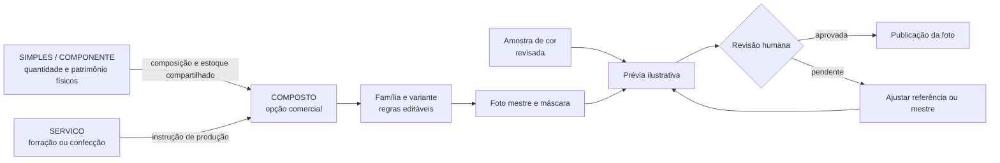
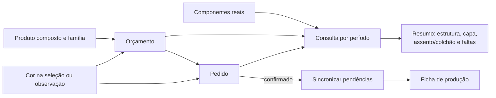
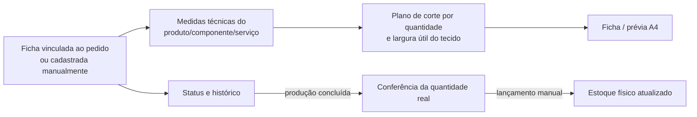

← [Voltar aos diagramas](../README.md)

# Blueprint V2 — catálogo visual e produção

**Retrato do desenvolvimento local em 30/10/2026.** Esta visão amplia o
[blueprint original](00-blueprint-geral.md), que permanece como referência do
ciclo de locação. Não indica que exista implantação de homologação ou produção.

## 1. Catálogo: do patrimônio à apresentação comercial

Uma estrutura, capa ou assento físicos são contados uma vez. A quantidade de
cores ou de produtos montados não multiplica o estoque nem o patrimônio.
Para forração sob demanda, a foto é contextual ao item; não cria capa.

## 2. Orçamento, pedido e disponibilidade

Uma cor de capa existente pode apontar para a variante física correspondente.
Uma cor nova permanece identificada para produção. Na forração sem capa,
apenas a estrutura limita o estoque; tecido e serviço entram no planejamento.
O estado de disponibilidade depende do período e da composição cadastrada.

## 3. Produção, tecido e estoque

A ficha não aumenta estoque por mudar de status. O cálculo de tecido usa as
peças descritas na ficha técnica; se existir apenas consumo linear, a tela
apresenta uma referência de compra, sem inventar o formato do molde. O plano
consolidado soma fichas por material e cor, mas não reaproveita automaticamente
retalhos entre produtos diferentes.

## Estado da V2

| Área | Situação neste retrato |
| --- | --- |
| Cadastro de famílias, vínculos, amostras e mestres | Implementado na instalação local, com revisão humana |
| Cor contextual em orçamento e pedido | Implementada; continuar homologação por família |
| Consulta temporal de componentes | Integrada; conferir produtos novos e composições |
| Pendências, ficha, impressão e plano de corte | Implementados; moldes dependem das medidas cadastradas |
| Migração completa para uma instalação limpa | Pendente: parte do esquema e dos dados visuais ainda é local |
| Ambientes separados de desenvolvimento, homologação e produção | Ainda não formalizados |

## Próxima etapa de cadastro

As mesas devem seguir a mesma separação entre tampo/pés físicos, produto
comercial composto e eventual serviço de forração. Cada apresentação precisa
de compatibilidade física e preço comercial próprios; o estoque e o
patrimônio continuam nos componentes. A aprovação de um mestre e a inclusão
de medidas de corte são etapas distintas da criação do produto.

Detalhes de código e limites estão em
[Motor de cores, produtos compostos e produção](../../arquitetura/motor-cores-e-producao.md).
